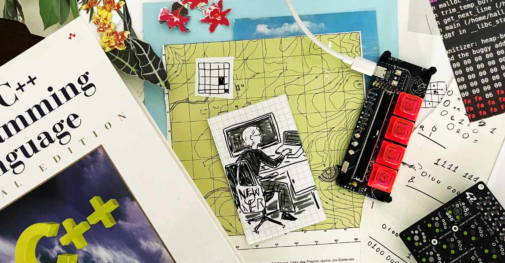

## Hilary Allison
Software engineering student at 42 Berlin, focused on low level software development. I come from a creative background and am interested in embedded systems and cybersecurity.

### 42 Core Curriculum Projects:
- Webserv: an HTTP 1.0 server, based on nginx | C++
- Ford Johnson Algorithm: comparison-efficient sorting algorithm | C++
- Minishell: a Bash-like shell | C
- MiniRT: a ray tracer | C
- FdF: Wireframe model renderer | C
- 3DTTT: a 3D tic-tac-toe web app | Typescript, node.js, Express

### Personal Projects:
- Disarray Desnarler: customizable, solder-it-yourself macropad running QMK

 

---
